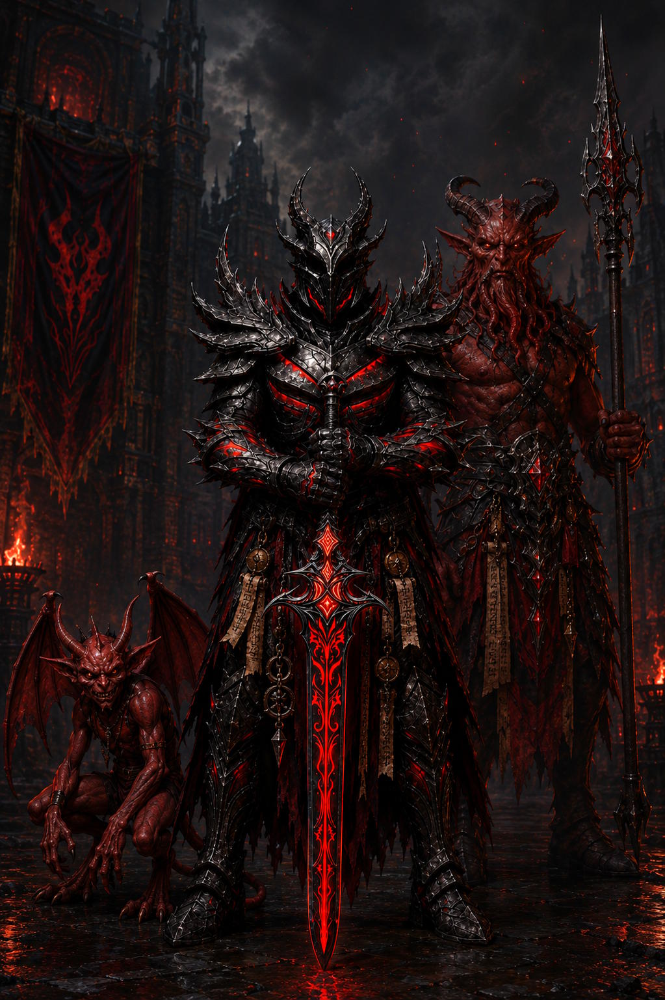
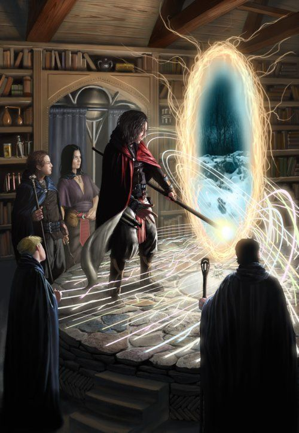

# Subclasses

```{r, layout="l-body-outset", echo=FALSE}
Cleric_Domains <- read_csv("_data/Cleric_Domains.csv", show_col_types = FALSE)
#kable(Cleric_Domains)

Print_Domain <- function(Domain) {
  Domain_Table <- Cleric_Domains %>%
    select(all_of(c("Cleric Level", Domain))) %>%
    rename("Prepared Spells" = all_of(Domain))
  kable(Domain_Table)
}
```

## Cleric: Diabolic Domain

::: center-img
{width="70%"}
:::

While not openly worshiped among civilized society, Asmodeus commands a following easily comparable to any other deity, whom congregate behind closed doors of many a reputable establishment. His teachings urges followers to pursue the accumulation of wealth and power, manipulate and control those whom can help you achieve this, and utterly dominate those who stand in your way.

Clerics of the Diabolic Domain may swear fealty to another Archfiend, but ultimately their power stems from Asmodeus' Divinity along with the Nine Hells themselves. Below is a selection of abilities granted to such clerics.

::: sub-heading
Level 3: Diabolic Domain Spells
:::

Your connection to this divine domain ensures you always have certain spells ready. When you reach a Cleric level specified in the Diabolic Domain Spells table, you thereafter always have the listed spells prepared.

**Diabolic Domain Spells**

```{r, layout="l-body-outset", echo=FALSE}
Print_Domain("Diabolic")
```
::: sub-heading
Level 3: Infernal Rejuvenation
:::

As a Magic action, you present your Holy Symbol and expend a use of your Channel Divinity to emit a flash of unholy green energy that can restore a number of Hit Points equal to five times your Cleric level. You may target yourself and any number of creatures within 30ft of you of the Fiend creature type, and divide those Hit Points among them. Creatures healed by this may also end one of following conditions affecting them: Blinded, Deafened, Paralyzed, Poisoned.

::: sub-heading
Level 3: Silver Tongued Devil
:::

You gain proficiency in the Deception and Persuasion skills. You can also use your Wisdom modifier in place of Charisma when making checks with these skills.

Additionally, you gain the service of an Imp Familiar to aid with your infernal dealings. You learn the Find Familiar spell and can cast it without expending material components. When using this spell, the spirit is always a Fiend which takes the form of an Imp.

::: sub-heading
Level 6: Hellfire Mastery
:::

At 6th level you are granted mastery over the conjuring and manipulation of Hellfire. When you cast a spell which deals Fire damage, this damage ignores a creature's fire resistance. In addition, If you or any allies within 30ft are forced to make a save against a spell or effect dealing fire damage, they automatically succeed.

::: sub-heading
Level 17: As Asmodeus Wills It
:::

At 17th Level you gain full authority over one lesser devil under your command. You can cast a special version of the Infernal Calling spell. When casting this version, the duration is permanent and the creature is placed under the effects of the Planar Binding spell, compelling it to follow your orders to the best of it's ability. You can have one such creature under your control in this way at a time. If you subsequently cast Infernal Calling while another creature is permanently bound you may choose either to instantly banish the other creature to it's home plane, or to temporarily conjure a second creature following the usual rules for for the spell.

***Optional:*** If you do not already possess one, Asmodeus may bestow upon his high ranking clerics a Devil's Talisman, potentially granting the ability to conjure more powerful devils with this spell such as a Horned Devil or Fire Hellion. Whether he chooses to do this will be determined by the Cleric's level of devotion and previous actions (*DM's Discretion*).

## Cleric: Dream Domain

::: sub-heading
Level 3: Dream Domain Spells
:::

Your connection to this divine domain ensures you always have certain spells ready. When you reach a Cleric level specified in the Dream Domain Spells table, you thereafter always have the listed spells prepared.

**Dream Domain Spells**

```{r, layout="l-body-outset", echo=FALSE}
Print_Domain("Dream")
```

## Cleric: Travel Domain

::: center-img
{width="70%"}
:::

The greatest stories of our time often tell of the journey one took to reach an impossible location, overcome perilous challenges, and discover the secrets of a vast, unexplored world. Such is the purview of the travel domain, and it's clerics whom almost exclusively embark upon the sort of expeditions typical for an adventuring party, rather than the humble life of a village priest. These clerics are the missionaries sent out to spread their gospel to new lands, the first to respond when a remote village is in desperate need of a healer, and the responsible adult making sure everyone gets home safe at the end of the night.

Travel domain clerics are not exclusive to any particular religion or deity, but often connect their worship to the great journeys of their pantheon: the quest for the Holy Grail, Odysseus' return from the Trojan War, or Odin's endless wanderings in search of knowledge.

::: sub-heading
Level 3: Divine Compass
:::

You gain proficiency in both Cartographer's Tools and Navigator's Tools. You have advantage on any checks where these tools can be utilized, or made to interpret, navigate by, or extract information from a map.

Additionally, you have a supernatural sense to divine the path forward. You always have the Augury spell prepared. When utilizing this spell to choose a path, direction, or course of action which involves travelling to a particular place, you can use your tools or map in place of the usual material components for the spell.

::: sub-heading
Level 3: Reposition
:::

As a Magic action, you present your Holy Symbol and expend a use of your Channel Divinity to invest your allies with a burst of mobility. Choose a number of creatures within 30ft up to your wisdom modifier (minimum of 1). This can include you. Each of the chosen creatures may choose one of the following options:

 - The creature may instantly move up up to its speed, without provoking opportunity attacks (no action required).
 - The creature may use their reaction to make a skill check in an attempt to break free from one effect restricting their movement, gaining advantage on the roll.
 - The creature may use their reaction to make a saving throw to end one effect on them causing them to be paralyzed or restrained.

::: sub-heading
Level 3: Travel Domain Spells
:::

Your connection to this divine domain ensures you always have certain spells ready. When you reach a Cleric level specified in the Travel Domain Spells table, you thereafter always have the listed spells prepared.

**Travel Domain Spells**

```{r, layout="l-body-outset", echo=FALSE}
Print_Domain("Travel")
```

::: sub-heading
Level 6: Mounted Expedition
:::

When you cast Phantom Steed, you can conjure a number of mounts equal to 1 plus your Wisdom modifier (minimum of 2). Instead of a Riding Horse, the mounts have the statistics of a Warhorse, and can be Medium, Large or Huge, depending upon the needs of the rider. If one of the mounts take damage, that mount disappears and the rider floats harmlessly to the ground. The other mounts conjured by this spell are unaffected. If you cast the spell again, any remaining mounts conjured by this spell gradually fade over the course of one minute.

::: sub-heading
Level 17: Wayshrines
:::

You are able to create a network of sanctuaries and safe havens blessed by your deity which you can always travel back to, known as wayshrines. You always have the Word of Recall spell prepared, and can cast it once per long rest without expending a spell slot.

You can spend 1 week and 500gp to create a permanent shrine to your deity at a location which is friendly to you, such as an allied stronghold, a friendly temple, or a party member's ship. The owner of the location or vessel must be aware of and give permission for the creation of this shrine. These wayshrines can be anywhere in the campaign world including other planes as long as these conditions are met. As long as the shrine remains intact, the shrine can be used as the destination of your Word of Recall or Teleportation Circle spells (bypassing the need for a permanent teleportation circle at the destination). 

You can have a number of wayshrines active at any given time equal to your Wisdom modifier (minimum 1). If you add an additional wayshrine to the network beyond this number, you may choose which existing wayshrine is removed. Permanent temples to your deity you have visited since acquiring this feature, and the Sanctum bastion special facility, also count as wayshrines for the purpose of this feature but do not count against the limit of active wayshrines you can have at any given time.
